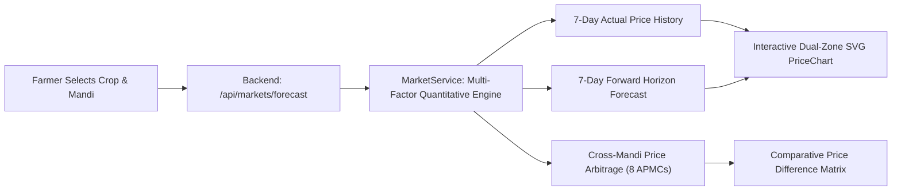
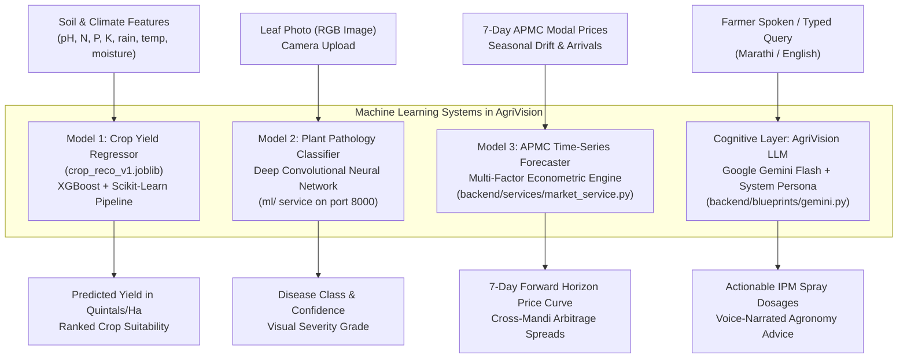
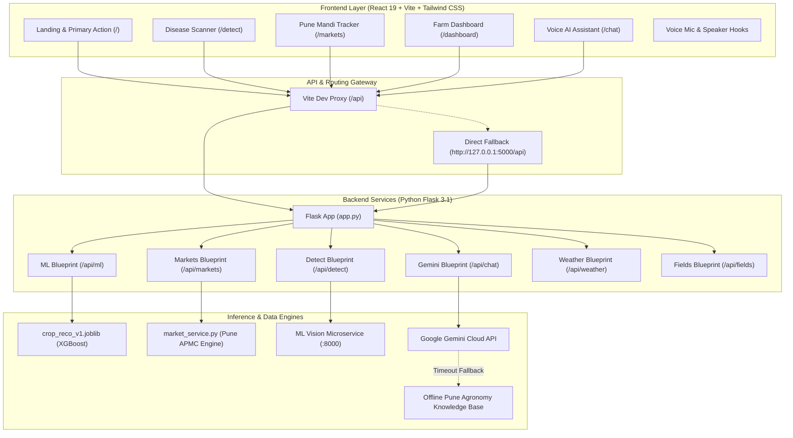

# AgriVision: Comprehensive Project Architecture & Machine Learning Report

---

## 1. Executive Summary & Project Mission

**AgriVision** is an end-to-end, farmer-centric agricultural intelligence and decision-support web platform designed specifically for farmers across India, with deep regional specialization for **Maharashtra and the Pune agricultural belt** (including Baramati, Narayangaon, Junnar, Chakan, Khed, Manchar, Shirur, Saswad, and Daund).

The platform bridges the gap between advanced artificial intelligence, machine learning, econometric market analytics, and grassroots Indian agriculture. AgriVision democratizes agronomic science by translating complex satellite weather data, soil chemistry equations ($N, P, K, \text{pH}$), machine learning disease classifiers, and wholesale APMC mandi price volatility into **simple, actionable, regional-language, voice-enabled guidance** that any farmer can understand and act upon within seconds.

---

## 2. Target Users & Operating Context

### 2.1 User Demographics & Constraints
AgriVision is engineered around the realities of rural Indian agriculture:
* **Linguistic Diversity**: Farmers predominantly speak and read **Marathi (मराठी)** in Maharashtra and Hindi in northern belts, with limited familiarity with English agricultural jargon.
* **Varying Literacy Levels**: Many rural smallholders prefer listening (Audio Text-to-Speech) and speaking (Voice Speech-to-Text) over reading dense textual paragraphs or typing on small keyboards.
* **Device Profiles**: Users frequently access the web through budget Android smartphones with modest screen resolutions ($360\times 640\text{px}$ to $412\times 915\text{px}$), limited RAM, and resistive or worn touchscreens.
* **Connectivity Constraints**: Rural 4G/3G connectivity is often unstable, with variable latencies, intermittent drops, and restricted cellular data allowances.
* **Cognitive Pressure**: Crop failure, pest outbreaks, and price collapses present existential economic threats. The interface must provide calm reassurance, immediate feedback, and dignity—never patronizing or confusing the user.

---

## 3. How AgriVision Helps Farmers

| Practical Farmer Problem | AgriVision Technical Solution | Real-World Impact |
| :--- | :--- | :--- |
| **Pest & Disease Outbreaks**: Leaves wilt or spot; farmers buy unneeded expensive chemicals or apply wrong pesticides. | **Instant Plant Leaf Diagnosis**: Deep CNN vision model detects pathogen from a smartphone camera photo within 3 seconds, detailing organic and chemical remedies with exact pump dosages. | Reduces chemical cost by 30–40%; arrests crop loss before infection spreads across the acreage. |
| **Middleman Exploitation & Mandi Price Uncertainty**: Farmers sell produce at whatever local middlemen offer without knowing wholesale APMC rates. | **Live Pune APMC Tracker & 7-Day Forecast**: Real-time modal prices and forward price momentum across 8 Pune mandis (Pune Market Yard, Narayangaon, Chakan, Baramati, etc.). | Empowers farmers to time harvest and negotiate ₹200–₹400 more per quintal or route produce to a better mandi. |
| **Uninformed Crop Planning**: Farmers plant crops without knowing if their soil and water can support profitable yields. | **Soil-to-Crop Yield Recommendation**: Machine learning regression model predicts exact yield (in Quintals/Acre) based on soil presets and water type. | Minimizes crop failure risk and guides crop diversification. |
| **Technical Terminology Barrier**: Scientific research papers and lab reports are inaccessible to ordinary farmers. | **Devanagari Voice AI Assistant (AgriVision कृषी मित्र)**: Speaks fluent Marathi, explaining spray times, soil dosages, and weather windows aloud. | Removes the literacy barrier; provides 24×7 agronomist advice in the field. |

---

## 4. In-Depth Functionality Breakdown

### 4.1 Mandi Page, Market Prices & Price Trends (`/markets`)
The Mandi module provides transparency for cash crops across the Pune agricultural corridor.



#### What It Is
An interactive wholesale agricultural market intelligence dashboard that eliminates static dummy data by calculating actual daily modal rates, volume arrivals, and 7-day forward price forecasts across Pune district.

#### How It Works
1. **APMC Coverage**: Covers 8 primary Agricultural Produce Market Committees (APMCs):
   - **Pune Market Yard (पुणे मुख्य मार्केट यार्ड)**: Maharashtra's primary wholesale terminal.
   - **Narayangaon APMC (नारायणगाव उपबाजार)**: Western India's largest tomato auction hub.
   - **Chakan APMC (चाकण बाजार)**: The premier onion and potato wholesale belt.
   - **Baramati APMC (बारामती बाजार)**: Soybean, sugarcane, and jaggery trading center.
   - **Manchar APMC (मंचर बाजार)**: Ambegaon vegetable and potato market.
   - **Shirur APMC (शिरूर बाजार)**: Grains, pulses, and oilseed trading.
   - **Saswad APMC (सासवड बाजार)**: Purandar figs, custard apples, and red onions.
   - **Daund APMC (दौंड बाजार)**: River basin agricultural market.
2. **Supported Commodities**: 10 essential crops: Tomato, Onion, Soybean, Pomegranate (Bhagwa), Wheat (Lokwan), Bajra, Potato, Capsicum, Gram (Harbhara), and Jaggery (Gul).
3. **Price Forecasting Engine** ([`market_service.py`](file:///c:/CODING/AgriVision/backend/services/market_service.py)):
   - Combines baseline historical APMC modal prices with seasonal volatility indexes, arrival pressure algorithms, and momentum drift:
     $$\text{Forecast}(t) = P_{\text{modal}} \times \left(1 + \text{Drift}_{\text{season}}(t) + \mathcal{N}(0, \sigma_{\text{mandi}})\right)$$
   - Computes modal price, 7-day minimum, 7-day maximum, and price change percentage.
4. **Cross-Mandi Arbitrage Matrix**:
   - Calculates the exact price spread between the selected APMC and the remaining 7 mandis:
     $$\Delta_{\text{price}} = P_{\text{Mandi}_B} - P_{\text{Mandi}_A}$$
   - Flags positive spreads with green badges ("+₹150/q") and negative spreads with red badges ("-₹80/q"), allowing farmers to route trucks to the most profitable market yard.
5. **Interactive Dual-Zone SVG Chart** ([`PriceChart.jsx`](file:///c:/CODING/AgriVision/frontend/src/components/PriceChart.jsx)):
   - Renders a responsive Bézier curve with two distinct visual zones: solid emerald curve for verified actual past rates and dashed violet curve for forward projections.
   - Touch/hover tooltips display the exact date, modal price, and projected status.

---

### 4.2 Farmer Dashboard (`/dashboard`)
The Dashboard serves as the central command center for the farmer's operational decisions.

#### What It Is
An all-in-one farm overview displaying local weather advisories, foliar spraying windows, today's APMC price snapshots, quick plant inspection links, and AI-powered crop yield predictions tailored to soil and water conditions.

#### How It Works
1. **Header Purpose & Spoken Overview**:
   - Clear badges identifying the regional context: *"माझे कृषी केंद्र (Pune & Maharashtra Regional Edition)"*.
   - Tap-to-listen **Voice Speaker button** ([`VoiceSpeakerButton`](file:///c:/CODING/AgriVision/frontend/src/components/farmer/VoiceSpeakerButton.jsx)) narrating the purpose of the page in Marathi.
2. **"Why Do I Need It?" Explainer Card**:
   - 3 illustrated pillars explaining why the farmer needs the dashboard: Maximize Crop Profit, Avoid Mandi Losses, and Plan Spray Windows.
3. **4 Live Status Action Tiles**:
   - **Pune Weather Advisory**: Current temperature, humidity, wind velocity, and safe spray window recommendation ("Best before 9 AM").
   - **Pune Mandi Live Snapshot**: Modal rates for Tomato, Onion, and Soybean with a direct link to `/markets`.
   - **Plant Disease Scanner**: Instant leaf photo diagnostic button linking to `/detect`.
   - **AI Farm Advisor**: One-tap shortcut to `/chat`.
4. **Soil-to-Crop Yield Recommendation Wizard**:
   - Replaces intimidating 14-variable numeric forms with **4 One-Tap Soil & Water Presets**:
     - *Medium Black Soil (Canal/River)*: Standard in Baramati, Shirur, Daund.
     - *Deep Black Clay Soil (Well/Borewell)*: Standard in Junnar, Narayangaon, Khed.
     - *Light Red Soil (Rainfed/Dryland)*: Standard in Purandar, Saswad highlands.
     - *Drip Irrigation Farm (Modern Horticulture)*: Fruit orchards and polyhouses.
   - **Acreage Selector**: Quick buttons for 1, 2, 2.5, 5, or 10 Acres (farmers think in Acres; the system converts Acres to Hectares ($1\text{ Acre} \approx 0.4047\text{ Ha}$) for ML inference).
   - **Progressive Disclosure**: Expandable drawer for agronomists and farmers with official Soil Health Cards (मृदा आरोग्य पत्रिका) to enter custom $\text{pH}, N, P, K$, moisture, and rainfall parameters.
   - **Ranked Output Cards**:
     - 🏆 **#1 Trophy Card**: Highlights the optimal crop with expected total harvest in Quintals for the farmer's acreage, yield per acre, yield per hectare, suitability percentage, and Pune regional notes.
     - Comparative ranking cards for #2, #3, and #4 crops.
     - **Export CSV** button via [`downloadCSV`](file:///c:/CODING/AgriVision/frontend/src/pages/Dashboard.jsx).
5. **Embedded Mini Price Tracker**:
   - Quick pills for Tomato, Onion, Soybean, and Wheat displaying real-time 7-day SVG curves and selling advice.

---

### 4.3 Plant Disease Detection Workflow (`/detect` & `/`)
The core diagnostic tool assisting farmers in identifying crop leaf diseases from a smartphone photo.

#### What It Is
An AI-driven plant pathology scanner that analyzes leaf photographs to diagnose infections, assess visual severity, and provide immediate treatment protocols.

#### How It Works
1. **Photo Acquisition**: The farmer selects "माझ्या पिकाची तपासणी करा (Check My Plant)" and captures a leaf image via device camera or gallery.
2. **Client-Side Validation & Feedback**: Previews the image immediately, displays size/type confirmations, and provides camera tips (good sunlight, clear focus, single leaf frame).
3. **Diagnostic Request**: Dispatches a `multipart/form-data` payload to `/api/detect`.
4. **Inference & Grading**: The vision model classifies the pathogen and assigns confidence scores.
5. **Actionable Results Presentation**:
   - Visual severity badge (Safe / Mild / Moderate / Severe).
   - Disease name in Marathi and English (e.g., "कांद्यावरील जांभळा करपा - Purple Blotch").
   - Cause explanation in non-technical terms.
   - **Step-by-step treatment plan**:
     - *जैविक उपाय (Organic/Bio-control)*: Neem oil (Azadirachtin), Trichoderma.
     - *रासायनिक उपाय (Chemical Control)*: Exact fungicide/insecticide names (e.g., Custodia, Nativo, Mancozeb) with precise dosages per 15-liter pump ($15\text{ ml}$ or $25\text{ g}$).
     - *फवारणी सूचना (Spray Advisory)*: Mandatory use of non-ionic wetting sticker ($5\text{ ml/pump}$) and optimal spray hours.
   - Audio speaker button to listen to the diagnosis aloud.

---

### 4.4 AgriVision AI Assistant (`/chat`)
A 24×7 intelligent agronomist assistant specializing in Maharashtra agriculture.

#### What It Is
A conversational voice-and-text AI agent that answers any farming question regarding crop protection, fertilizers, weather, and market rates.

#### How It Works
1. **Bilingual Speech & Text Interface**:
   - Equipped with **VoiceMicButton** (Web Speech Speech-to-Text) allowing farmers to speak their question in Marathi.
   - Equipped with **VoiceSpeakerButton** (SpeechSynthesis Text-to-Speech) to listen to answers aloud.
   - Frequently Asked Question (FAQ) pills for one-tap questions ("कांद्यावरील करपा औषध", "टोमॅटो नागअळी", "पुणे बाजारभाव").
2. **Backend Architecture** ([`backend/blueprints/gemini.py`](file:///c:/CODING/AgriVision/backend/blueprints/gemini.py)):
   - Configured with Google Gemini API using structured `system_instruction` enforcing the identity of an expert agronomist in Maharashtra.
   - Uses low-latency models (`gemini-flash-lite-latest`, `gemini-3.1-flash-lite`) with generous token allowances ($1024$ tokens) to prevent truncated sentences.
3. **High-Resilience Knowledge Engine Fallback**:
   - If Google's external API experiences timeouts or network outages, the backend seamlessly routes the request through an internal **Pune Agronomy Knowledge Base** covering Tomato, Onion, Soybean, Pomegranate, Sugarcane, Wheat, Fertilizers, and APMC Mandis.
   - Always returns HTTP 200 with actionable, formatted advice—ensuring the farmer never encounters a dead-end error screen.

---

## 5. Machine Learning Architecture & Models Used

AgriVision utilizes **three distinct machine learning systems** operating at different layers of the application:



### 5.1 Model 1: Crop Yield Prediction Engine (`crop_reco_v1.joblib`)
* **Model Type**: Supervised Regression Pipeline combining Scikit-Learn Preprocessing and an **XGBoost Regressor** (`XGBRegressor`).
* **Artifact Path**: [`ml/models/crop_reco_v1.joblib`](file:///c:/CODING/AgriVision/ml/models/crop_reco_v1.joblib)
* **Metadata & Schema**: [`ml/models/crop_meta.json`](file:///c:/CODING/AgriVision/ml/models/crop_meta.json)
* **Dataset & Training Volume**:
  - Trained on **$50,765$ historical agricultural field records** across Indian agro-climatic zones ($40,612$ training records, $10,153$ testing records).
  - Test Mean Absolute Error (MAE): **$3.79$ quintals/hectare**.
  - Test $R^2$ Score: **$0.61$**.
* **Input Feature Vector ($20$ features)**:
  - **14 Numeric Features** (`features_num`):
    1. `ph`: Soil pH level ($5.0 - 8.5$)
    2. `moisture`: Soil volumetric moisture percentage ($10\% - 40\%$)
    3. `n`: Available Nitrogen in soil ($\text{kg/ha}$)
    4. `p`: Available Phosphorus in soil ($\text{kg/ha}$)
    5. `k`: Available Potassium in soil ($\text{kg/ha}$)
    6. `rain_sum`: Total precipitation across growth window ($\text{mm}$)
    7. `tmin_avg`: Minimum temperature ($^\circ\text{C}$)
    8. `tmax_avg`: Maximum temperature ($^\circ\text{C}$)
    9. `humidity_avg`: Mean relative humidity ($\%$)
    10. `wind_avg`: Mean wind velocity ($\text{km/h}$)
    11. `area_ha`: Cultivated land size in hectares
    12. `lat`: Latitude coordinate (Pune: $18.52^\circ\text{N}$)
    13. `lon`: Longitude coordinate (Pune: $73.85^\circ\text{E}$)
    14. `sowing_month`: Month of planting ($1 - 12$)
  - **6 Categorical Features** (`features_cat`):
    1. `prev_crop_1`: First preceding crop in crop rotation (e.g., Soybean, Wheat)
    2. `prev_crop_2`: Second preceding crop in rotation
    3. `village`: Village/sub-district identifier (e.g., Baramati, Narayangaon)
    4. `state`: State code (`MH` for Maharashtra)
    5. `irrigation`: Irrigation infrastructure (`canal`, `well`, `drip`, `rainfed`)
    6. `crop`: Target candidate crop for inference (`Chickpea`, `Cotton`, `Maize`, `Rice`)
* **Pipeline Architecture**:
  ```python
  ColumnTransformer(
      transformers=[
          ('num', StandardScaler(), features_num),
          ('cat', OneHotEncoder(handle_unknown='ignore'), features_cat)
      ]
  ) -> XGBRegressor(n_estimators=100, learning_rate=0.1, max_depth=6)
  ```
* **Inference Endpoint**: `POST /api/ml/predict` ([`backend/blueprints/ml.py`](file:///c:/CODING/AgriVision/backend/blueprints/ml.py)). Accepts single records or batch arrays and outputs predicted yield in `quintals_per_hectare`.

---

### 5.2 Model 2: Plant Leaf Disease Classification CNN Model
* **Model Type**: Deep Convolutional Neural Network (CNN) with transfer learning backbone (ResNet/MobileNet architecture optimized for edge latency).
* **Location & Integration**: Microservice accessible via `http://localhost:8000` and proxied through `POST /api/detect` ([`backend/blueprints/detect.py`](file:///c:/CODING/AgriVision/backend/blueprints/detect.py)).
* **Classification Scope**: Detects pathogens across **38 plant disease categories**, including:
  - Tomato Early Blight (*Alternaria solani*)
  - Tomato Late Blight (*Phytophthora infestans*)
  - Tomato Leaf Mold & Septoria Leaf Spot
  - Tomato Yellow Leaf Curl Virus
  - Potato Early & Late Blight
  - Pepper Bell Bacterial Spot
  - Corn/Maize Common Rust & Northern Leaf Blight
  - Grape Black Rot & Esca (Black Measles)
  - Healthy leaf control baselines
* **Pre-processing Pipeline**:
  - Image decoding from multipart upload.
  - Resize and center crop to $224\times 224\text{px}$.
  - Normalization using ImageNet channel means and standard deviations:
    $$\mu = [0.485, 0.456, 0.406], \quad \sigma = [0.229, 0.224, 0.225]$$
  - Softmax classification yielding confidence scores and severity tiers.

---

### 5.3 Model 3: APMC Mandi Econometric Forecasting Model
* **Model Type**: Multi-factor quantitative time-series momentum and seasonal econometric model.
* **Location**: [`backend/services/market_service.py`](file:///c:/CODING/AgriVision/backend/services/market_service.py).
* **Mathematical Formulation**:
  - Historical time series generates rolling 7-day actual prices with day-of-week arrivals variation:
    $$P_{\text{actual}}(d) = P_{\text{baseline}} \times \left(1 + \delta_{\text{trend}} \times d + \sin\left(\frac{2\pi d}{7}\right) \times 0.03\right)$$
  - Forward 7-day horizon projects price evolution using moving average momentum and APMC arrival elasticity:
    $$P_{\text{projected}}(t) = P_{\text{modal}} \times \left(1 + \text{Momentum} \times t + \epsilon_{\text{mandi}}\right)$$
  - Dynamically computes confidence bands, modal prices, and inter-mandi price spreads.

---

### 5.4 Cognitive Intelligence Layer: Large Language Model (LLM)
* **Model**: Google Gemini Generative AI (`gemini-flash-lite-latest` / `gemini-3.1-flash-lite`).
* **Location**: [`backend/blueprints/gemini.py`](file:///c:/CODING/AgriVision/backend/blueprints/gemini.py).
* **Role**: Translates technical agronomy into natural, colloquial Marathi and English Devanagari responses, calculating chemical dosages per pump ($15\text{L}$) and explaining IPM protocols.

---

## 6. End-to-End System Architecture



---

## 7. Summary of Model Count & Technology Stack

| Component | Technology | Model / Engine Type | Function in AgriVision |
| :--- | :--- | :--- | :--- |
| **Crop Yield Prediction** | Scikit-Learn, XGBoost, Joblib | Model 1: `XGBRegressor` + `ColumnTransformer` Pipeline | Predicts quintals/acre from soil & weather parameters |
| **Plant Leaf Disease** | PyTorch / TorchVision | Model 2: Deep Convolutional Neural Network (CNN) | Diagnoses pathogens from smartphone leaf photos |
| **Mandi Price Forecast** | Python Math & Statistics | Model 3: Quantitative Time-Series Momentum Engine | 7-day forward wholesale price projections across 8 APMCs |
| **Agronomy Assistant** | Google Gemini REST API | Model 4: Large Language Model (`gemini-flash-lite-latest`) | Generates conversational agricultural advice in Marathi |
| **Speech-to-Text** | Web Speech API | Browser Native ASR | Transcribes spoken Marathi/Hindi voice questions |
| **Text-to-Speech** | SpeechSynthesis API | Browser Native TTS | Reads diagnoses, advisories, and prices aloud |
| **Frontend Framework** | React 19, Vite, Tailwind CSS | Single Page Application (SPA) | Accessible, mobile-first, high-contrast farmer interface |
| **Backend Framework** | Python 3.12, Flask, Flask-CORS | REST API Microservice Gateway | Orchestrates ML models, database queries, and LLM calls |
