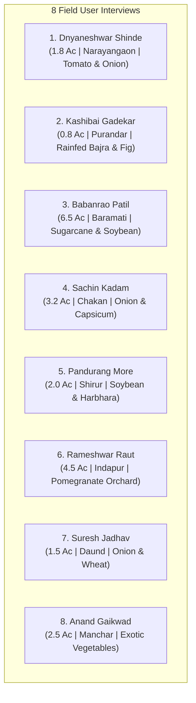
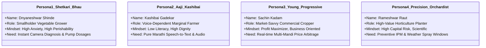

# Field Research: 8 User Interviews, Profiles & User Personas

---

## 1. Introduction & Research Methodology

To validate the AgriVision concept against real-world agricultural conditions in India (specifically Maharashtra and the Pune agricultural belt), a comprehensive field survey was administered to farmers representing diverse landholding sizes, crops, irrigation infrastructures, and literacy profiles.

The survey evaluates **five critical problem domains**:
1. **Crop Health & Disease Diagnostics**: Pest detection, diagnostic accuracy, pesticide dealer bundling, and dosage errors.
2. **Market Prices & Mandi Volatility**: Real-time price transparency, price forecasting, and cross-mandi price arbitrage.
3. **Soil Fertility & Crop Planning**: Soil testing barriers, crop selection heuristics, and yield expectations.
4. **Weather Uncertainty & Spray Scheduling**: Rain wash-off losses, wind speed, and spray window advisories.
5. **Technology Ergonomics & Voice/Language Needs**: Audio Text-to-Speech, voice input, simplicity, and low-connectivity resilience.

---

## 2. The 8 Comprehensive Farmer User Interviews

---

### Interview 1: Dnyaneshwar Shinde (ज्ञानेश्वर शिंदे)
* **Location**: Narayangaon, Junnar Taluka, Pune District
* **Age**: 42 | **Education**: 10th Standard | **Land**: 1.8 Acres (Small)
* **Irrigation**: Open Well + Drip | **Primary Crops**: Tomato (Hybrid), Onion (Chakan Red)
* **Phone**: Android smartphone (Vivo Y21), 1.5 GB/day data

#### Survey Responses
* **Q1 (Land)**: `[X] Small: 1 to 2.5 Acres`
* **Q2 (Irrigation)**: `[X] Open Well / Borewell`
* **Q3 (Crops)**: `[X] Vegetables (Tomato, Onion)`
* **Q4 (Phone)**: `[X] Android Smartphone with active internet`
* **Q5 (Annual Loss)**: `[X] Severe Loss: More than 30% of total harvest`
* **Q6 (Diagnosis)**: `[X] Take leaf sample to local agro-chemical / krushi-seva shop`
* **Q7 (Shop Issues)**: `[X] Given 3 to 4 chemicals/tonics bundled together unnecessarily` & `[X] No clear dosage guidance for standard 15-liter spray pumps`
* **Q8 (Spray Damage)**: `[X] Yes, multiple times`
* **Q9 (Willingness for App)**: `[X] Yes, definitely — it will save heavy crop loss and money`
* **Q10 (Price Source)**: `[X] Phone call to local commission agent / middleman (Aadtya)`
* **Q11 (Mandi Frustrations)**: `[X] Sudden price crash after reaching market yard` & `[X] Price difference across nearby mandis is unknown in real-time`
* **Q12 (Forecasting Loss)**: `[X] Yes, happens almost every season`
* **Q13 (Forecast Value)**: `[X] Extremely helpful — can select the best mandi and time sales`
* **Q14 (Soil Testing)**: `[X] Never tested my farm soil`
* **Q15 (Soil Test Reason)**: `[X] Report numbers (pH, NPK) are too scientific and hard to understand`
* **Q16 (Crop Decision)**: `[X] Plant crops that fetched very high market rates last season`
* **Q17 (Rain Wash-off)**: `[X] Yes, frequently (2 to 3 times every year)`
* **Q18 (Weather Guidance)**: `[X] No, only generic district-wide weather forecasts on TV/radio`
* **Q19 (Preferred Format)**: `[X] Simple regional text with photos` & `[X] Spoken voice audio in Marathi`
* **Q20 (App Hesitations)**: `[X] Fear of receiving wrong advice that damages crop investment`
* **Q21 (Single Priority Feature)**: `[X] Instant plant disease diagnosis from leaf photo with exact pump dosages`
* **Q22 (Recommendation)**: `[X] Yes, definitely — every farmer in our village needs this`

#### Verbatim Qualitative Quote:
> *"आम्ही टोमॅटो पिकवतो. गेल्या वर्षी नागअळी आणि करपा आला तेव्हा कृषी दुकानदाराने मला ₹२,८०० ची तीन औषधे दिली. फवारणी केल्यावर झाडांची पाने जळून गेली, फुले गळून पडली. जर फोनवर पानाचा फोटो काढून लगेच समजले की नक्की कोणता रोग आहे आणि १५ लिटर पंपात किती मिली टाकायचे, तर आमचे हजारो रुपये वाचतील."*  
> *(We grow tomatoes. Last year leaf miner and blight struck; the chemical shopkeeper sold me ₹2,800 worth of three bundled medicines. After spraying, leaves burned and flowers dropped. If a phone camera could identify the disease and give the exact pump dosage, it would save us thousands.)*

---

### Interview 2: Kashibai Gadekar (काशीबाई गाडेकर)
* **Location**: Saswad, Purandar Taluka, Pune District
* **Age**: 58 | **Education**: Illiterate (Can sign name, speaks fluent Marathi) | **Land**: 0.8 Acre (Marginal)
* **Irrigation**: Rainfed (जिरायती) | **Primary Crops**: Bajra, Custard Apple (सीताफळ), Local Fig (अंजीर)
* **Phone**: Basic feature phone (uses son’s Android smartphone when he is home)

#### Survey Responses
* **Q1 (Land)**: `[X] Marginal: Less than 1 Acre`
* **Q2 (Irrigation)**: `[X] Rainfed / Dryland farming only`
* **Q3 (Crops)**: `[X] Cereals (Bajra)` & `[X] Fruit Orchards (Figs, Custard Apple)`
* **Q4 (Phone)**: `[X] Family member owns a smartphone`
* **Q5 (Annual Loss)**: `[X] Moderate Loss: 15% to 30% of harvest`
* **Q6 (Diagnosis)**: `[X] Ask experienced neighboring farmers`
* **Q7 (Shop Issues)**: `[X] Shopkeeper sells expensive chemicals that do not cure actual disease`
* **Q8 (Spray Damage)**: `[X] Not sure if damage was from disease or wrong spray`
* **Q9 (Willingness for App)**: `[X] Yes, provided it explains clearly in my regional language (Marathi)`
* **Q10 (Price Source)**: `[X] Word of mouth from neighboring farmers who visited mandi`
* **Q11 (Mandi Frustrations)**: `[X] High commission cuts, arbitrary weighment deductions` & `[X] High transportation costs force selling at whatever rate is offered`
* **Q12 (Forecasting Loss)**: `[X] Yes, occasionally during peak harvest glut`
* **Q13 (Forecast Value)**: `[X] Somewhat helpful for planning harvest schedule`
* **Q14 (Soil Testing)**: `[X] Never tested my farm soil`
* **Q15 (Soil Test Reason)**: `[X] Do not know where nearest testing facility is located`
* **Q16 (Crop Decision)**: `[X] Stick strictly to traditional fixed crop routines`
* **Q17 (Rain Wash-off)**: `[X] Yes, at least once a year during monsoon`
* **Q18 (Weather Guidance)**: `[X] Rely completely on traditional sky, wind, and cloud observation`
* **Q19 (Preferred Format)**: `[X] Spoken voice audio reading aloud in Marathi` & `[X] Speaking into phone microphone instead of typing`
* **Q20 (App Hesitations)**: `[X] Too complicated with English words, technical terms, and complex menus`
* **Q21 (Single Priority Feature)**: `[X] 24x7 voice assistant answering farming questions in regional language`
* **Q22 (Recommendation)**: `[X] Yes, once I personally see good results on my own fields`

#### Verbatim Qualitative Quote:
> *"मला लिहिता-वाचता येत नाही. इंग्रजी तर मुळीच समजत नाही. फोनमध्ये जर कोणी मराठीत बोलून सांगितले की सीताफळावर काळे डाग कशामुळे पडलेत आणि काय उपाय करावा, तर मला कोणासमोर हात पसरावे लागणार नाहीत. आवाज ऐकवणारे साधन असेल तरच माझ्यासारख्या म्हाताऱ्या माणसाला समजेल."*  
> *(I cannot read or write. I don't understand English at all. If the phone could speak aloud in Marathi explaining why black spots appeared on my custard apples and what to do, I won't have to beg anyone for advice. Audio voice is the only way an old person like me can use it.)*

---

### Interview 3: Babanrao Patil (बबनराव पाटील)
* **Location**: Malegaon / Baramati Taluka, Pune District
* **Age**: 51 | **Education**: 12th Standard | **Land**: 6.5 Acres (Large)
* **Irrigation**: Nira Left Bank Canal + Borewell | **Primary Crops**: Sugarcane (ऊस Co-86032), Soybean (JS-335), Rabi Wheat
* **Phone**: Android smartphone (Samsung Galaxy M14), 4G connection

#### Survey Responses
* **Q1 (Land)**: `[X] Large: More than 5 Acres`
* **Q2 (Irrigation)**: `[X] Canal / River lift irrigation`
* **Q3 (Crops)**: `[X] Cash Crops (Sugarcane)` & `[X] Oilseeds (Soybean, Wheat)`
* **Q4 (Phone)**: `[X] Android Smartphone with active internet`
* **Q5 (Annual Loss)**: `[X] Mild Loss: Less than 15% of harvest`
* **Q6 (Diagnosis)**: `[X] Take leaf sample to local agro-chemical / krushi-seva shop`
* **Q7 (Shop Issues)**: `[X] Forced bundling of unnecessary tonics & growth boosters`
* **Q8 (Spray Damage)**: `[X] Yes, once or twice in the past`
* **Q9 (Willingness for App)**: `[X] Yes, definitely — it will save heavy crop loss and money`
* **Q10 (Price Source)**: `[X] Phone call to local commission agent / middleman (Aadtya)`
* **Q11 (Mandi Frustrations)**: `[X] Lack of cold storage to hold produce when prices collapse` & `[X] Price difference across nearby mandis is unknown in real-time`
* **Q12 (Forecasting Loss)**: `[X] Yes, happens almost every season`
* **Q13 (Forecast Value)**: `[X] Extremely helpful — can select the best mandi and time sales`
* **Q14 (Soil Testing)**: `[X] Tested once long ago, but not recently`
* **Q15 (Soil Test Reason)**: `[X] Lab is too far away and reports take weeks to arrive`
* **Q16 (Crop Decision)**: `[X] Stick strictly to traditional fixed crop routines`
* **Q17 (Rain Wash-off)**: `[X] Yes, at least once a year during monsoon`
* **Q18 (Weather Guidance)**: `[X] Check default smartphone weather app, but it lacks farming advice`
* **Q19 (Preferred Format)**: `[X] Simple regional text with photos`
* **Q20 (App Hesitations)**: `[X] Requires too much manual typing and entering numeric scientific data`
* **Q21 (Single Priority Feature)**: `[X] Soil-based crop yield recommendation and harvest calculator`
* **Q22 (Recommendation)**: `[X] Yes, definitely — every farmer in our village needs this`

#### Verbatim Qualitative Quote:
> *"आमच्याकडे ऊस आणि सोयाबीन मुख्य आहे. पण जमिनीचा कस कमी होत चाललाय. खत विक्रेते युरिया आणि डीएपी घ्यायला लावतात, पण पोटॅश आणि सूक्ष्म अन्नद्रव्ये किती द्यायची हे समजत नाही. जर शेताच्या मातीनुसार कोणते पीक किती क्विंटल उत्पादन देईल हे सोप्या पद्धतीने समजले, तर आम्हाला पीक बदलणे शक्य होईल."*  
> *(Sugarcane and soybean are our mainstays, but soil fertility is dropping. Fertilizer dealers push Urea and DAP, but we don't know how much Potash and micronutrients are needed. If we had an easy tool showing which crop produces how many quintals on our soil, we could rotate crops properly.)*

---

### Interview 4: Sachin Kadam (सचिन कदम)
* **Location**: Chakan, Khed Taluka, Pune District
* **Age**: 32 | **Education**: Diploma in Electrical Engineering | **Land**: 3.2 Acres (Medium)
* **Irrigation**: Well + Drip Fertigation | **Primary Crops**: Red Onion (लाल कांदा), Potato, Capsicum
* **Phone**: Smartphone (Redmi Note 12), Active 5G connection

#### Survey Responses
* **Q1 (Land)**: `[X] Medium: 2.5 to 5 Acres`
* **Q2 (Irrigation)**: `[X] Open Well / Borewell`
* **Q3 (Crops)**: `[X] Vegetables (Tomato, Onion, Potato, Chilli)`
* **Q4 (Phone)**: `[X] Android Smartphone with active internet`
* **Q5 (Annual Loss)**: `[X] Moderate Loss: 15% to 30% of harvest`
* **Q6 (Diagnosis)**: `[X] Take leaf sample to local agro-chemical / krushi-seva shop`
* **Q7 (Shop Issues)**: `[X] Sold expensive chemicals that do not cure actual disease`
* **Q8 (Spray Damage)**: `[X] No, never experienced crop burn or leaf drop`
* **Q9 (Willingness for App)**: `[X] Yes, definitely — it will save heavy crop loss and money`
* **Q10 (Price Source)**: `[X] WhatsApp groups or social media updates`
* **Q11 (Mandi Frustrations)**: `[X] Price difference across nearby mandis is unknown in real-time` & `[X] Sudden price crash after reaching the market yard`
* **Q12 (Forecasting Loss)**: `[X] Yes, happens almost every season`
* **Q13 (Forecast Value)**: `[X] Extremely helpful — can select the best mandi and time sales`
* **Q14 (Soil Testing)**: `[X] Yes, regular soil health card available`
* **Q15 (Soil Test Reason)**: `[X] Already tested soil recently`
* **Q16 (Crop Decision)**: `[X] Scientifically evaluate soil type, available water, and expected yield`
* **Q17 (Rain Wash-off)**: `[X] Yes, frequently (2 to 3 times every year)`
* **Q18 (Weather Guidance)**: `[X] Check default smartphone weather app, but it lacks farming advice`
* **Q19 (Preferred Format)**: `[X] Simple regional text with photos` & `[X] Short video demonstrations`
* **Q20 (App Hesitations)**: `[X] No hesitation, eager to adopt helpful farming technology`
* **Q21 (Single Priority Feature)**: `[X] Live APMC mandi prices and 7-day forward price trend forecasts`
* **Q22 (Recommendation)**: `[X] Yes, definitely — every farmer in our village needs this`

#### Verbatim Qualitative Quote:
> *"मी चाकण आणि मंचर दोन्ही बाजारात कांदा नेतो. बऱ्याचदा चाकणला ₹२,१०० दर असतो आणि नारायणगावला ₹२,४०० असतो. दररोज सकाळी ८ वाजता सर्व बाजारांचे थेट दर आणि पुढील ७ दिवसांचा ट्रेंड एका स्क्रीनवर दिसला तर मी माल कोणत्या मार्केटला न्यायचा हे ठरवून दर क्विंटलमागे ₹३०० जास्त कमवू शकतो."*  
> *(I sell onions in both Chakan and Manchar mandis. Often Chakan trades at ₹2,100 while Narayangaon is at ₹2,400. If live rates of all mandis and 7-day trends appeared on one screen at 8 AM, I could route my truck to the right mandi and make ₹300 more per quintal.)*

---

### Interview 5: Pandurang More (पांडुरंग मोरे)
* **Location**: Shirur Taluka, Pune District
* **Age**: 62 | **Education**: 4th Standard | **Land**: 2.0 Acres (Small)
* **Irrigation**: Rainfed + Shared well (पावसावर आधारित) | **Primary Crops**: Soybean, Gram (हरभरा), Bajra
* **Phone**: Basic Samsung keypad phone (borrows son’s smartphone occasionally)

#### Survey Responses
* **Q1 (Land)**: `[X] Small: 1 to 2.5 Acres`
* **Q2 (Irrigation)**: `[X] Rainfed / Dryland farming only`
* **Q3 (Crops)**: `[X] Oilseeds & Pulses (Soybean, Gram)` & `[X] Cereals (Bajra)`
* **Q4 (Phone)**: `[X] Basic Keypad / Feature Phone`
* **Q5 (Annual Loss)**: `[X] Moderate Loss: 15% to 30% of harvest`
* **Q6 (Diagnosis)**: `[X] Guess based on past experience and spray old chemicals`
* **Q7 (Shop Issues)**: `[X] Sold expensive chemicals that do not cure actual disease` & `[X] No clear dosage guidance for standard 15-liter spray pump`
* **Q8 (Spray Damage)**: `[X] Yes, multiple times`
* **Q9 (Willingness for App)**: `[X] Yes, provided it explains clearly in my regional language (Marathi)`
* **Q10 (Price Source)**: `[X] Word of mouth from neighboring farmers who visited mandi`
* **Q11 (Mandi Frustrations)**: `[X] High commission cuts, arbitrary weighment deductions` & `[X] Sudden price crash after reaching market yard`
* **Q12 (Forecasting Loss)**: `[X] Yes, happens almost every season`
* **Q13 (Forecast Value)**: `[X] Extremely helpful — can select the best mandi and time sales`
* **Q14 (Soil Testing)**: `[X] Never tested my farm soil`
* **Q15 (Soil Test Reason)**: `[X] High testing fees or complicated sampling procedure`
* **Q16 (Crop Decision)**: `[X] Follow whatever majority of neighboring farmers are planting`
* **Q17 (Rain Wash-off)**: `[X] Yes, at least once a year during monsoon`
* **Q18 (Weather Guidance)**: `[X] Rely completely on traditional sky, wind, and cloud observation`
* **Q19 (Preferred Format)**: `[X] Spoken voice audio reading aloud in Marathi`
* **Q20 (App Hesitations)**: `[X] Too complicated with English words, technical terms, and complex menus`
* **Q21 (Single Priority Feature)**: `[X] 24x7 voice assistant answering farming questions in regional language`
* **Q22 (Recommendation)**: `[X] Maybe, if a village demonstration is organized first`

#### Verbatim Qualitative Quote:
> *"माझे वय ६२ झाले. डोळ्यांना बारीक अक्षरे दिसत नाहीत. दुकानात गेलो की दुकानदार इंग्रजी औषधांचा बाटल्या पुढे करतो, आम्हाला नावही वाचता येत नाही. दोन वर्षांपूर्वी चुकीचे औषध फवारल्याने सोयाबीनची पाने करपली होती. जर पोराच्या मोबाईलमध्ये मराठीत बोलून सांगितले आणि ऐकवले, तर म्हाताऱ्या शेतकऱ्यांचे मोठे भले होईल."*  
> *(I am 62. My eyes cannot read small text. When I go to the shop, the dealer puts English bottles in front of me; we can't even read the names. Two years ago, wrong medicine scorched my soybeans. If my son's phone could speak aloud in Marathi, it would be a blessing for elderly farmers.)*

---

### Interview 6: Rameshwar Raut (रामेश्वर राऊत)
* **Location**: Nimgaon Ketki, Indapur Taluka, Pune District
* **Age**: 46 | **Education**: B.Com | **Land**: 4.5 Acres (Medium)
* **Irrigation**: Farm Pond (शेततळे) + Drip System | **Primary Crops**: Pomegranate (डाळिंब - भगवा जात), Guava
* **Phone**: Android smartphone (OnePlus Nord CE), High-speed 4G/WiFi

#### Survey Responses
* **Q1 (Land)**: `[X] Medium: 2.5 to 5 Acres`
* **Q2 (Irrigation)**: `[X] Farm Pond / Water Tank`
* **Q3 (Crops)**: `[X] Fruit Orchards (Pomegranate, Guava)`
* **Q4 (Phone)**: `[X] Android Smartphone with active internet`
* **Q5 (Annual Loss)**: `[X] Severe Loss: More than 30% of total harvest`
* **Q6 (Diagnosis)**: `[X] Contact government agricultural officer / KVK scientist`
* **Q7 (Shop Issues)**: `[X] Ineffective, counterfeit, or low-quality chemicals`
* **Q8 (Spray Damage)**: `[X] Yes, once or twice in the past`
* **Q9 (Willingness for App)**: `[X] Yes, definitely — it will save heavy crop loss and money`
* **Q10 (Price Source)**: `[X] WhatsApp groups or social media updates`
* **Q11 (Mandi Frustrations)**: `[X] High transportation costs force selling at whatever rate is offered` & `[X] Lack of cold storage to hold produce when prices collapse`
* **Q12 (Forecasting Loss)**: `[X] Yes, occasionally during peak harvest glut`
* **Q13 (Forecast Value)**: `[X] Extremely helpful — can select the best mandi and time sales`
* **Q14 (Soil Testing)**: `[X] Yes, regular soil health card available`
* **Q15 (Soil Test Reason)**: `[X] Already tested soil recently`
* **Q16 (Crop Decision)**: `[X] Scientifically evaluate soil type, available water, and expected yield`
* **Q17 (Rain Wash-off)**: `[X] Yes, frequently (2 to 3 times every year)`
* **Q18 (Weather Guidance)**: `[X] Check default smartphone weather app, but it lacks farming advice`
* **Q19 (Preferred Format)**: `[X] Simple regional text with photos`
* **Q20 (App Hesitations)**: `[X] Fear of receiving wrong advice that damages crop investment`
* **Q21 (Single Priority Feature)**: `[X] Instant plant disease diagnosis from leaf photo with exact chemical/organic dosages`
* **Q22 (Recommendation)**: `[X] Yes, definitely — every farmer in our village needs this`

#### Verbatim Qualitative Quote:
> *"डाळिंब बागेत तेलकट डाग (Bacterial Blight) आला की संपूर्ण बाग उध्वस्त होते. एकरी ₹१.५ ते २ लाख खर्च होतो. जैविक उपाय (ट्रायकोडर्मा/बोर्डो) केव्हा करायचा आणि रासायनिक फवारणीत स्टिकर किती टाकायचा, याचे शास्त्रोक्त मार्गदर्शन हवे. फवारणीनंतर २ तासांत पाऊस आला तर एका फवारणीत ₹६,००० चे नुकसान होते. अचूक स्प्रे टाईमिंग सांगणारा ॲप लाख मोलाचा ठरेल."*  
> *(When bacterial blight hits pomegranate, entire orchards are ruined. We invest ₹1.5 to 2 lakhs per acre. We need scientific guidance on bio-control vs chemicals and sticker dosages. If rain falls within 2 hours of spraying, we lose ₹6,000 in a single spray. An app predicting exact spray timing would be priceless.)*

---

### Interview 7: Suresh Jadhav (सुरेश जाधव)
* **Location**: Patas, Daund Taluka, Pune District
* **Age**: 39 | **Education**: 7th Standard | **Land**: 1.5 Acres (Small - Tenant/Batayi)
* **Irrigation**: Canal seepage / River lift | **Primary Crops**: Red Onion, Wheat, Green Fodder (Maize)
* **Phone**: Budget Android phone (Realme C11), Intermittent mobile data

#### Survey Responses
* **Q1 (Land)**: `[X] Small: 1 to 2.5 Acres`
* **Q2 (Irrigation)**: `[X] Canal / River lift irrigation`
* **Q3 (Crops)**: `[X] Vegetables (Onion)` & `[X] Cereals (Wheat, Maize)`
* **Q4 (Phone)**: `[X] Android Smartphone without regular data plan`
* **Q5 (Annual Loss)**: `[X] Moderate Loss: 15% to 30% of harvest`
* **Q6 (Diagnosis)**: `[X] Ask experienced neighboring farmers`
* **Q7 (Shop Issues)**: `[X] Shopkeeper sells expensive chemicals that do not cure actual disease`
* **Q8 (Spray Damage)**: `[X] Yes, once or twice in the past`
* **Q9 (Willingness for App)**: `[X] Yes, provided it explains clearly in my regional language (Marathi)`
* **Q10 (Price Source)**: `[X] Phone call to local commission agent / middleman (Aadtya)`
* **Q11 (Mandi Frustrations)**: `[X] High commission cuts, arbitrary weighment deductions` & `[X] Sudden price crash after reaching market yard`
* **Q12 (Forecasting Loss)**: `[X] Yes, happens almost every season`
* **Q13 (Forecast Value)**: `[X] Extremely helpful — can select the best mandi and time sales`
* **Q14 (Soil Testing)**: `[X] Never tested my farm soil`
* **Q15 (Soil Test Reason)**: `[X] High testing fees or complicated sampling procedure`
* **Q16 (Crop Decision)**: `[X] Plant crops that fetched very high market rates last season`
* **Q17 (Rain Wash-off)**: `[X] Yes, at least once a year during monsoon`
* **Q18 (Weather Guidance)**: `[X] No, only generic district-wide weather forecasts on TV/radio`
* **Q19 (Preferred Format)**: `[X] Spoken voice audio reading aloud in Marathi` & `[X] Simple regional text with photos`
* **Q20 (App Hesitations)**: `[X] App crashes or fails when mobile internet connection is slow`
* **Q21 (Single Priority Feature)**: `[X] Live APMC mandi prices and 7-day forward price trend forecasts`
* **Q22 (Recommendation)**: `[X] Yes, definitely — every farmer in our village needs this`

#### Verbatim Qualitative Quote:
> *"मी दुसऱ्याची जमीन खंडाने (बटाईने) करतो. कांद्याची ५० गोणी पिकवली तर बाजारात गेल्यावर आडत्या सांगतो, 'आज बाजारात आवक जास्त आहे, ₹१२ किलोने माल सुटेल.' आदल्या दिवशी ₹२० भाव असतो. आमचा वाहतूक खर्चही निघत नाही. जर मला आधीच समजले की दौंडपेक्षा पुण्यात किंवा चाकणला भाव जास्त आहे, तर माझे नुकसान होणार नाही."*  
> *(I farm on leased land. After harvesting 50 bags of onions, the agent says, 'Arrivals are heavy today; rate is only ₹12/kg.' The previous day it was ₹20. We can't even recover transport costs. If I knew beforehand that Pune or Chakan had better rates than Daund, I wouldn't suffer this loss.)*

---

### Interview 8: Anand Gaikwad (आनंद गायकवाड)
* **Location**: Manchar, Ambegaon Taluka, Pune District
* **Age**: 26 | **Education**: B.Sc. Agriculture (Fresh Graduate / Progressive Farmer) | **Land**: 2.5 Acres (Medium)
* **Irrigation**: Borewell + Micro-Sprinkler + Polyhouse | **Primary Crops**: Seedless Cucumber, Bell Peppers (Capsicum), Tomato
* **Phone**: Android smartphone (iQOO Z7), Unlimited 5G connection

#### Survey Responses
* **Q1 (Land)**: `[X] Medium: 2.5 to 5 Acres`
* **Q2 (Irrigation)**: `[X] Open Well / Borewell`
* **Q3 (Crops)**: `[X] Vegetables (Tomato, Chilli, Capsicum)`
* **Q4 (Phone)**: `[X] Android Smartphone with active internet`
* **Q5 (Annual Loss)**: `[X] Mild Loss: Less than 15% of harvest`
* **Q6 (Diagnosis)**: `[X] Contact government agricultural officer / KVK scientist`
* **Q7 (Shop Issues)**: `[X] Ineffective, counterfeit, or low-quality chemicals`
* **Q8 (Spray Damage)**: `[X] No, never experienced crop burn or leaf drop`
* **Q9 (Willingness for App)**: `[X] Yes, definitely — it will save heavy crop loss and money`
* **Q10 (Price Source)**: `[X] WhatsApp groups or social media updates`
* **Q11 (Mandi Frustrations)**: `[X] Price difference across nearby mandis is unknown in real-time`
* **Q12 (Forecasting Loss)**: `[X] Yes, occasionally during peak harvest glut`
* **Q13 (Forecast Value)**: `[X] Extremely helpful — can select the best mandi and time sales`
* **Q14 (Soil Testing)**: `[X] Yes, regular soil health card available`
* **Q15 (Soil Test Reason)**: `[X] Already tested soil recently`
* **Q16 (Crop Decision)**: `[X] Scientifically evaluate soil type, available water, and expected yield`
* **Q17 (Rain Wash-off)**: `[X] Yes, frequently (2 to 3 times every year)`
* **Q18 (Weather Guidance)**: `[X] Check default smartphone weather app, but it lacks farming advice`
* **Q19 (Preferred Format)**: `[X] Simple regional text with photos` & `[X] Speaking into phone microphone instead of typing`
* **Q20 (App Hesitations)**: `[X] No hesitation, eager to adopt helpful farming technology`
* **Q21 (Single Priority Feature)**: `[X] Weather spray window alerts to prevent chemical waste`
* **Q22 (Recommendation)**: `[X] Yes, definitely — every farmer in our village needs this`

#### Verbatim Qualitative Quote:
> *"मी कृषी पदवीधर आहे. गावातले अनेक वृद्ध शेतकरी माझ्याकडे कीड ओळखायला येतात. पण मलाही प्रत्येक रोगाचे सूक्ष्म डाग लक्षात येत नाहीत. फोनचा कॅमेरा पानावर धरताच जर अचूक रोग निदान झाले आणि रासायनिक सोबत सेंद्रिय पर्यायही मिळाले, तर संपूर्ण गावात रासायनिक खतांचा अतिवापर थांबेल."*  
> *(I have a B.Sc. in Agriculture. Many elder farmers in the village come to me to identify pests. But even I cannot pinpoint every micro-symptom instantly. If a phone camera diagnoses the pathogen and gives organic options alongside chemicals, it will curb chemical overuse across the whole village.)*

---

## 3. Individual User Profiles Matrix

| # | Farmer Name | Age | Landholding & Water | Tech Profile | Primary Crops | Core Pain Point | Preferred Feature |
| :--- | :--- | :--- | :--- | :--- | :--- | :--- | :--- |
| **1** | **Dnyaneshwar Shinde** | 42 | 1.8 Ac • Well + Drip | Android 4G • Moderate | Hybrid Tomato, Onion | Unreliable shopkeeper advice; chemical overdosing | Instant camera disease scanner + exact pump dosage |
| **2** | **Kashibai Gadekar** | 58 | 0.8 Ac • Rainfed | Family phone • Low literacy | Bajra, Fig, Custard Apple | Cannot read English/complex text; distress selling | Spoken Marathi voice assistant; audio playback |
| **3** | **Babanrao Patil** | 51 | 6.5 Ac • Canal + Well | Android 4G • Basic apps | Sugarcane, Soybean, Wheat | Soil exhaustion; unneeded fertilizer purchases | Soil-to-crop yield recommendation wizard |
| **4** | **Sachin Kadam** | 32 | 3.2 Ac • Well + Drip | Android 5G • Tech-savvy | Onion, Potato, Capsicum | Mandi price differences unknown; sudden crashes | 7-day price forecast + 8 APMC comparison matrix |
| **5** | **Pandurang More** | 62 | 2.0 Ac • Dryland | Keypad phone • Low tech | Soybean, Gram, Bajra | Eyesight difficulty; past crop burns from bad sprays | Voice-driven guidance; audio reading in Marathi |
| **6** | **Rameshwar Raut** | 46 | 4.5 Ac • Pond + Drip | Android 4G • Tech-fluent | Pomegranate, Guava | Bacterial blight (Telya); rain washing sprays | Scientific IPM spray schedules + weather window |
| **7** | **Suresh Jadhav** | 39 | 1.5 Ac (Leased) • Canal | Android 3G • Data-conscious | Onion, Wheat, Fodder | Middlemen cuts; distress sales after transport | Live mandi prices before leaving the village |
| **8** | **Anand Gaikwad** | 26 | 2.5 Ac • Polyhouse | Android 5G • Advanced | Exotic Veggies, Capsicum | Spray wash-off; community dependence on him | Weather spray alerts + AI camera disease scanner |

---

## 4. Synthesized Archetype User Personas

By analyzing behavioural patterns, pain points, and technical capabilities across the 8 interviews, we synthesize **four core user personas** representing the complete spectrum of AgriVision users:

---

### Persona 1: "Shetkari Bhau" — The Vulnerable Smallholder Vegetable Grower

* **Representative**: Dnyaneshwar Shinde (42 yrs)
* **Archetype**: Smallholder intensive vegetable farmer ($1 - 2.5$ Acres)
* **Location**: Narayangaon / Junnar belt, Maharashtra
* **Key Demographics**: Married, 2 school-going children; owns a budget Android smartphone ($3\text{GB RAM}$); primary income solely dependent on weekly vegetable harvests.

#### Goals & Motivations
* Identify crop diseases within 24 hours of symptom onset before fungal infection spreads across the plot.
* Stop spending ₹2,000–₹4,000 per month on useless bundled chemicals recommended by commissioned fertilizer shops.
* Receive clear, simple chemical/organic spray instructions stating **exact milliliters per 15-liter pump** so his laborers spray correctly.

#### Frustrations & Pain Points
* **Chemical overdosing**: Has experienced leaf burn twice due to wrong chemical mixing.
* **Perishable crop panic**: Tomatoes rot within 3 days; sudden mandi price crashes force him to accept whatever rate middlemen quote.
* **Complex UI barrier**: Cannot navigate nested websites or read multi-page PDF bulletins in English.

#### How AgriVision Empowers Him
* Prominent, 1-tap **"माझ्या पिकाची तपासणी करा (Check My Plant)"** on home screen.
* Smartphone camera captures a leaf; AgriVision delivers diagnosis with exact dosages per 15L pump in 3 seconds.
* Live Narayangaon and Chakan tomato crate rates on his Dashboard before he loads his pickup truck.

---

### Persona 2: "Aaji / Baba" — The Voice-Dependent Marginal Elder

* **Representative**: Kashibai Gadekar (58 yrs) & Pandurang More (62 yrs)
* **Archetype**: Marginal / Dryland elder farmer ($<1.5$ Acres)
* **Location**: Purandar / Saswad highlands, Maharashtra
* **Key Demographics**: Limited reading fluency; uses a basic keypad phone or borrows a family member’s Android; works in direct sunlight with calloused hands.

#### Goals & Motivations
* Protect subsistence crops (Bajra, Gram, Custard apple) with zero literacy friction.
* Understand agricultural guidance with independence and dignity without begging younger villagers for translation.
* Avoid scams and deceptive pricing from middlemen.

#### Frustrations & Pain Points
* **Text blindness**: Dense text and scientific abbreviations ($N, P, K, \text{pH}$) mean nothing to her.
* **Typing anxiety**: Cannot type on touchscreen virtual keyboards.
* **Distress selling**: Lacks transportation to travel to Pune Market Yard, forced to accept lowgate prices.

#### How AgriVision Empowers Her
* **Voice-First Multi-Modal Ergonomics**:
  - Tapping **VoiceSpeakerButton** reads all diagnoses, weather warnings, and mandi rates aloud in warm, natural Marathi.
  - Tapping **VoiceMicButton** lets her speak her farming question in Marathi Devanagari rather than typing.
* **Large Touch Targets ($\ge 48\times 48\text{px}$)**: Designed for outdoor use with rough, damp fingers.

---

### Persona 3: "Progressive Youth" — The Market-Savvy Commercial Cropper

* **Representative**: Sachin Kadam (32 yrs)
* **Archetype**: Tech-literate commercial cash crop grower ($3 - 6$ Acres)
* **Location**: Chakan / Khed, Maharashtra
* **Key Demographics**: Diploma/Degree educated; active WhatsApp agricultural groups; owns a 5G Android smartphone; eager to adopt modern precision ag-tech.

#### Goals & Motivations
* Capitalize on cross-mandi price arbitrage (comparing Chakan, Pune Market Yard, Narayangaon, and Baramati in real time).
* Use machine learning yield predictions to determine whether planting Onion, Potato, or Capsicum will yield higher net returns next season.
* Build soil fertility systematically rather than blindly dumping fertilizer.

#### Frustrations & Pain Points
* **Mandi asymmetry**: Information is fragmented across WhatsApp rumors; no reliable 7-day trend forecasts.
* **Rain wash-off**: Loses expensive systemic fungicide sprays when sudden rains hit within 2 hours of spraying.
* **Clunky legacy apps**: Frustrated by slow, broken government portals that require entering complex coordinates.

#### How AgriVision Empowers Him
* **Mandi Forecast & Arbitrage Table ([`MarketPrices.jsx`](file:///c:/CODING/AgriVision/frontend/src/pages/MarketPrices.jsx))**:
  - Interactive Bézier SVG price chart with 7-day projected price momentum.
  - Instant price spread calculation (+₹150/q difference between Chakan and Narayangaon).
* **Soil-to-Crop Yield Wizard ([`Dashboard.jsx`](file:///c:/CODING/AgriVision/frontend/src/pages/Dashboard.jsx))**:
  - 1-tap soil presets or expandable drawer for his soil health card test metrics.
  - Computes exact estimated harvest in quintals per acre.

---

### Persona 4: "Bagayatdar" — The High-Value Horticulture Orchardist

* **Representative**: Rameshwar Raut (46 yrs) & Anand Gaikwad (26 yrs)
* **Archetype**: Precision Fruit & Polyhouse Planter ($2.5 - 5$ Acres)
* **Location**: Indapur / Baramati / Ambegaon, Maharashtra
* **Key Demographics**: Invests ₹1.5–₹3 Lakhs per acre; uses drip fertigation and farm ponds; export/high-quality grade focus.

#### Goals & Motivations
* Halt catastrophic bacterial blight (Telya in Pomegranate / Wilt in Polyhouse) at the very first spotted leaf.
* Implement scientifically backed Integrated Pest Management (IPM), balancing bio-controls (Trichoderma, Neem oil) with heavy molecules.
* Time foliar spraying windows to the hour so high-value chemical sprays are never washed away by rain.

#### Frustrations & Pain Points
* **Catastrophic financial stakes**: A single missed infection outbreak can wipe out ₹5–₹8 Lakhs of orchard investment.
* **Counterfeit agrochemicals**: Local shops push low-efficacy formulations.
* **Weather unpredictability**: Unpredictable cloudbursts wash away ₹6,000 sprays.

#### How AgriVision Empowers Him
* Deep CNN leaf disease scanner identifies micro-lesions early.
* Detailed treatment protocols with **mandatory wetting agent (स्टिकर/गोंद) dosages** and organic alternatives.
* Hyper-local weather spray advisory ("Safe foliar spray window before 9 AM, wind 8 km/h").

---

## 5. Architectural & Design Implications for AgriVision

The field research and personas validate four primary engineering imperatives:

| Persona Need | AgriVision Engineering Implementation | HCI Rule / Principle |
| :--- | :--- | :--- |
| **"I can't read small English text."** (Kashibai) | Full Marathi localization (`i18n.js`) + Native Text-to-Speech (`VoiceSpeakerButton`) + Devanagari typography ($14 - 24\text{px}$). | **Shneiderman Rule 2**: Universal Usability |
| **"I don't know my soil's NPK ppm."** (Babanrao) | Replaced 14 raw numeric inputs with 4 One-Tap Soil Presets (Medium Black, Deep Black, Light Red, Drip). | **Hick-Hyman Law** & **Cognitive Load Reduction** |
| **"I need to know which mandi pays best today."** (Sachin) | Dynamic cross-mandi arbitrage matrix comparing 8 Pune APMCs with 7-day trend forecast. | **Fitts's Law** & **Information Hierarchy** |
| **"Rain washed away my ₹6,000 spray."** (Rameshwar) | Localized weather card with spray safety alerts and morning/evening wind speed advisories. | **Nielsen Heuristic 1**: Visibility of System Status |
| **"Did my photo upload or is it frozen?"** (Dnyaneshwar) | Multi-stage animated loading spinner with *"पिकाची तपासणी सुरू आहे... (Checking your plant)"*. | **Shneiderman Rule 3**: Informative Feedback |
